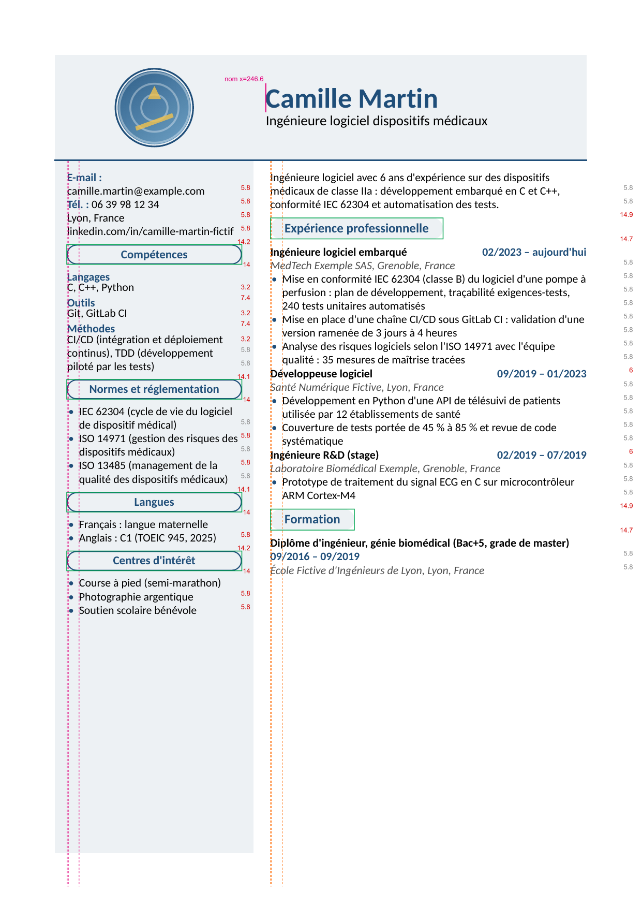
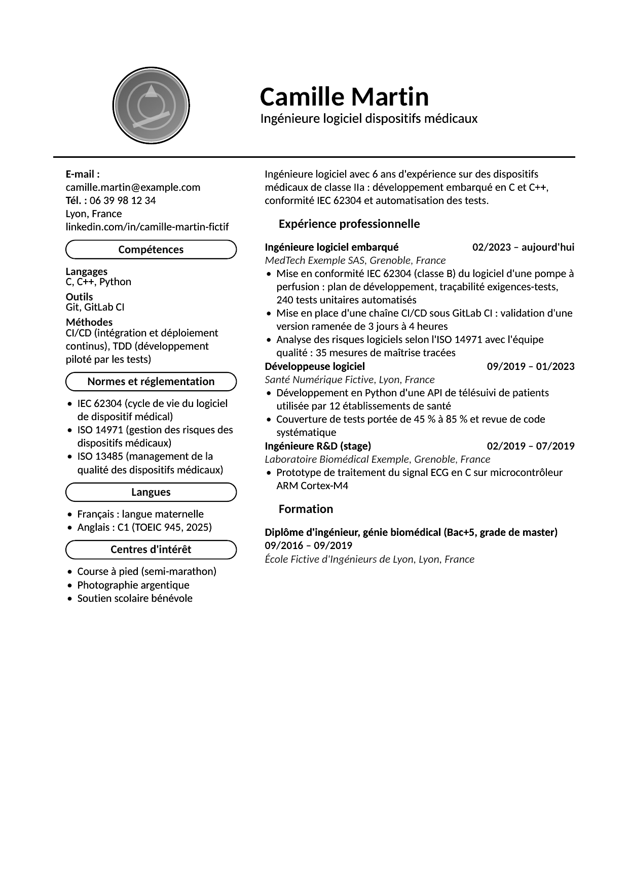
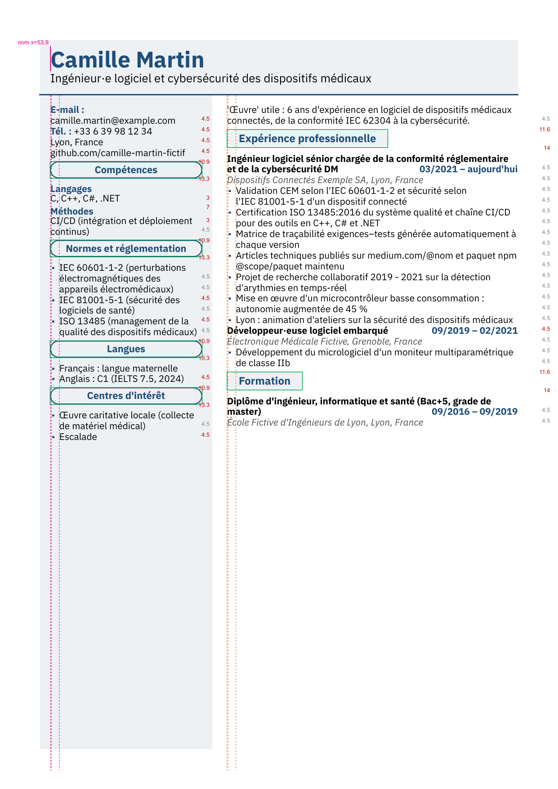
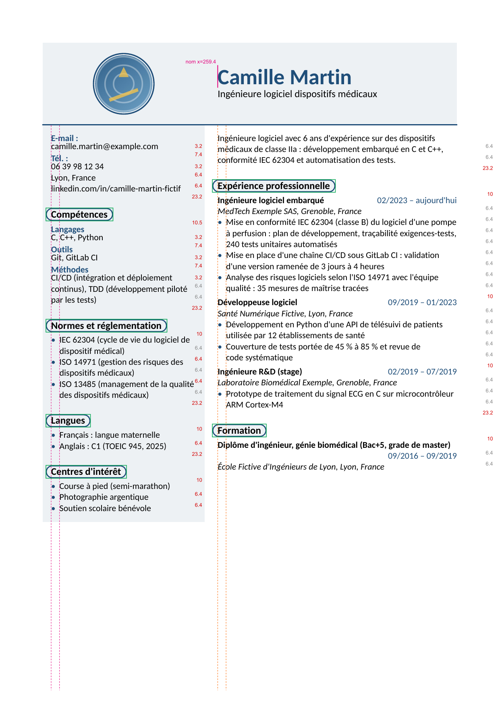
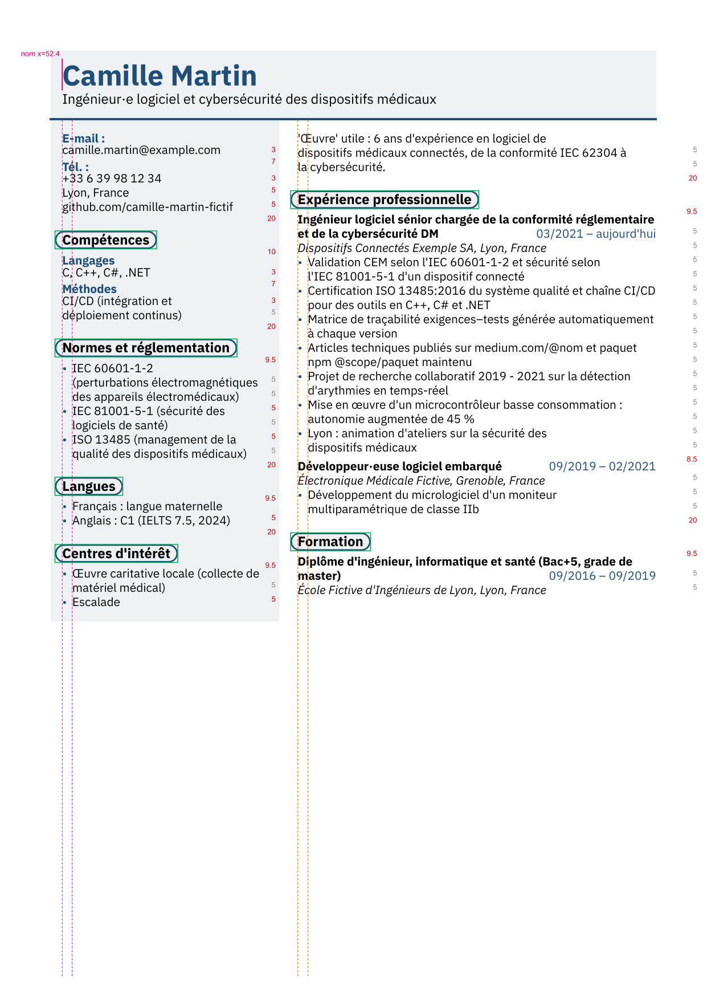
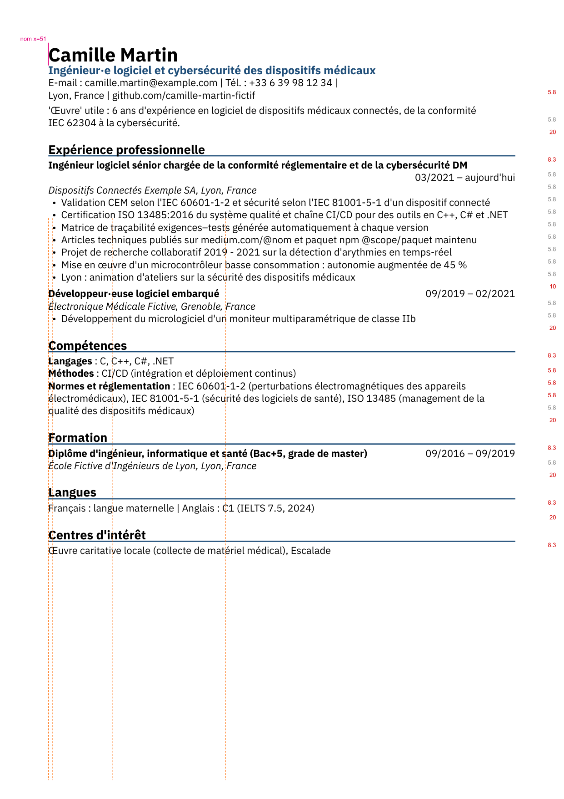

# Audit design du modèle visuel

- **Date** : 08/10/2026
- **Objet** : le gabarit [`visuel.typ`](../packages/render/templates/visuel.typ) (ADR 0019), passé à la batterie de tests de designer T-DES définie par la recherche [Critères de design de CV](Crit%C3%A8res%20de%20design%20de%20CV.md).
- **Méthode** : 60 rendus des personas fictives, jamais de données réelles :
  - 54 rendus de base : `courte`, `pieges`, `debordante` × Carlito, Source Sans 3, IBM Plex Sans × densité normale et compacte × FR, en-GB, en-US ;
  - 6 couleurs d'accent de plus, dont `#767676`, trop clair pour la teinte.

  Chaque PDF est mesuré automatiquement :
  - positions, corps et polices avec pdf.js ;
  - couleurs avec `pdftohtml` ;
  - fonds, pastilles et photo sur une image à 300 ppp (`pdftoppm`).

  Chaque texte reçoit son rôle (nom, intertitre, intitulé, dates, puce…) en alignant le texte extrait sur la projection. Les tests perceptifs sont simulés sur image : flou calibré sur la hauteur d'x, niveaux de gris, photocopie, impression « tout en noir », daltonisme, page à l'envers.

  La revue heuristique a été faite par **un seul évaluateur** (Claude), et non par trois à cinq comme le veut la méthode. Aucun test humain (test des 5 secondes, impression papier) n'a encore été fait.

- **Outillage** : `out/exp/design/battery.ts` (dossier ignoré par git), résultats par cas dans `out/design/cases/`, résumé dans `out/design/summary.md`.
- **Gravité** : échelle de Nielsen, de 0 (pas un problème) à 4 (catastrophe).

## Verdict

Le modèle tient ses règles d'intégrité et de couleur :

- une page, polices du thème, aucun débordement de colonne ;
- contraste AA partout (6,69:1 au minimum, 4,54:1 avec `#767676`), y compris en simulation de daltonisme (6,42:1 au minimum) ;
- marges et proportions dans les fourchettes ;
- le nom est le texte le plus sombre de la page.

**Son défaut central est le rythme vertical.** Tous les écarts de la colonne principale sont presque égaux :

- dans une entrée, entre deux entrées, autour des intertitres ;
- en densité compacte, ils valent tous exactement 4,5 pt.

Résultat : rien ne se groupe. Au flou, la colonne principale forme **une seule tache**. Les intertitres sont plus proches du bloc qui les précède que de leur propre contenu. S'y ajoutent :

- des intertitres principaux **parmi les éléments les plus pâles de la page** ;
- des dates qui quittent leur colonne quand l'intitulé est long, défaut que partage `ats-classique`.

Ces défauts pèsent surtout en densité compacte, celle qu'un CV chargé (comme le vôtre) finira par utiliser.

| Gravité | Défaut                                                                                   | Test               | Rendus touchés                                                   |
| ------- | ---------------------------------------------------------------------------------------- | ------------------ | ---------------------------------------------------------------- |
| 3       | Intertitres détachés de leur contenu, collés au bloc précédent                           | T-DES-21           | 54 / 54                                                          |
| 3       | Entrées non séparées (écart entre deux postes = interligne)                              | T-DES-20, T-DES-33 | 54 / 54                                                          |
| 3       | Intertitres principaux plus pâles que les intitulés et que le texte latéral              | T-DES-33, T-DES-29 | 54 / 54                                                          |
| 3       | Dates rejetées à gauche, hors de leur colonne (aussi dans `ats-classique`)               | T-DES-09           | 10 / 54 (29 autres : dates une ligne plus bas, restées à droite) |
| 2       | Interligne trop serré en compact (109 à 115 %)                                           | T-DES-22           | 27 / 27 compacts, et Carlito normal (119 %)                      |
| 2       | Cinq ou six corps, à 5–9 % l'un de l'autre                                               | T-DES-23           | 54 / 54                                                          |
| 2       | Deux signatures d'intertitre (corps, alignement, largeur)                                | revue, T-DES-07    | 54 / 54                                                          |
| 2       | Bas de page vide sous une colonne teintée qui descend jusqu'en bas                       | T-DES-26           | 36 / 36 CV d'une page                                            |
| 2       | « E-mail : » seul sur sa ligne ; URL réduite à 9,71 pt (6e corps)                        | T-DES-28, T-DES-07 | 33 / 54 ; 12 / 54                                                |
| 2       | Presque-alignements de 1 pt (puces) et de 4,3 pt (nom, avec photo)                       | T-DES-25           | 54 / 54                                                          |
| 2       | Cinq rôles en gras couleur d'accent ; intitulé et dates distingués par la couleur seule  | T-DES-06           | 54 / 54                                                          |
| 1–2     | Teinte effacée à la photocopie ; accent et gris deviennent le même gris ; traits de 1 pt | T-DES-29, T-DES-30 | toutes les couleurs teintées                                     |
| 1       | Lignes creuses (un seul mot sur la dernière ligne)                                       | T-DES-32           | 54 / 54                                                          |
| 1       | Phrases de trois lignes dans la colonne latérale                                         | T-DES-24           | 54 / 54                                                          |
| 1       | Photo sans texte de remplacement (bloque un export PDF/UA)                               | T-DES-35           | rendus avec photo                                                |

## Défauts en détail

### 1. Les intertitres flottent, du côté du bloc précédent (gravité 3)

- **Mesure** : blanc entre le bas du texte qui précède et le haut de la pastille, contre blanc entre le bas de la pastille et le texte qui suit.

  | Densité  | Au-dessus    | En dessous   | Rapport     |
  | -------- | ------------ | ------------ | ----------- |
  | Normale  | 5,0 à 6,3 pt | 8,3 à 9,0 pt | 0,59 à 0,71 |
  | Compacte | 2,2 à 3,5 pt | 7,9 à 8,6 pt | 0,27 à 0,41 |

  En compact, la pastille touche presque la ligne qui la précède. D'une ligne de base à la suivante, sans compter la pastille, les écarts sont égaux en normal (14,1–14,9 pt au-dessus contre 14,0–14,7 pt en dessous) et inversés en compact (10,9–11,6 contre 13,3–14,0).

- **Seuil** : au moins 1,5 fois plus d'espace au-dessus qu'en dessous, 2 visé. Le texte d'une section doit être plus proche de son titre que de la section précédente (NN/g, proximité ; Butterick, _Space above and below_).
- **Cause** : la pastille est une boîte en ligne avec des marges intérieures. Les 9 pt (6 pt en compact) placés au-dessus du bloc ([visuel.typ:40](../packages/render/templates/visuel.typ:40), [:51](../packages/render/templates/visuel.typ:51)) sont mangés par la marge de la pastille, alors que l'espace du dessous (0,6 em, [:52](../packages/render/templates/visuel.typ:52)) s'ajoute à celle du bloc suivant. Les valeurs viennent de la table des densités, [project.ts:55](../packages/core/src/project.ts:55) et [:65](../packages/core/src/project.ts:65).
- **Correction proposée** : régler l'espace sur la pastille elle-même, pas sur le texte : au moins deux fois plus d'espace au-dessus de la pastille qu'en dessous. T-DES-21 vérifie le résultat.

### 2. Les entrées ne se détachent pas (gravité 3)

- **Mesure** : d'une ligne de base au haut des capitales de la ligne suivante, l'écart vaut :
  - en densité normale, **6,0 pt** entre deux postes contre **5,77 pt** entre deux lignes d'un même poste (rapport 1,04) ;
  - en compact, **4,5 pt** partout (rapport 1,00).

  Le flou de 2,5 hauteurs d'x fond toute la colonne principale en **une seule tache**, intertitres compris.

- **Seuil** : écart dans une entrée < écart entre entrées < écart entre sections, chaque palier au moins 1,5 fois le précédent (valeur proposée, faute de source chiffrée).
- **Cause** : `entryGap` vaut 6 pt (4 pt en compact) et l'interligne 0,55 em (0,45 em) ; le plus grand des deux espaces voisins l'emporte ([visuel.typ:70](../packages/render/templates/visuel.typ:70)).
- **Correction proposée** : un espace entre entrées d'au moins 1,5 fois l'interligne (environ 9 pt en normal, 7 pt en compact), pris sur le vide du bas de page (défaut 8).

### 3. Les intertitres principaux sont parmi les éléments les plus pâles (gravité 3)

- **Mesure** :
  - **Au flou d'une hauteur d'x**, les intertitres de la colonne principale arrivent au **7e à 10e rang de noirceur sur 13 ou 14 rôles**. Ils passent derrière les intitulés de poste, les intertitres et libellés latéraux, et même le texte courant de la colonne latérale. Au flou de 2,5 hauteurs d'x, ils tombent au **12e à 14e rang**, et sont les plus clairs de tous dans 24 rendus sur 54.
  - **En impression « tout en noir » suivie d'une photocopie**, la teinte de la pastille disparaît (luma 239–240, supprimée au-dessus de 235). Il ne reste qu'un texte gras de 12 pt, 1,14 fois le corps, décalé de 13 pt vers la droite par la marge de la pastille. On le distingue à peine d'un intitulé de poste.
- **Seuil** : un niveau de hiérarchie doit dominer le niveau inférieur sur au moins deux attributs, ou à 1,2 fois le corps (Williams ; Sensory Trust). Il doit aussi rester lisible en noir et blanc (France Travail, Welcome to the Jungle).
- **Cause** : un texte couleur d'accent sur la teinte claire est moins contrasté qu'un texte noir sur blanc, et 12 pt reste proche de 10,5 pt ([visuel.typ:45](../packages/render/templates/visuel.typ:45)).
- **Correction proposée** : un intertitre plus fort sans dépendre de la couleur, par exemple plus grand (13–14 pt), avec un filet ou une graisse plus marquée. Son texte doit s'aligner sur la colonne et non sur la marge de la pastille. Le test du flou et l'impression en noir le vérifient.

### 4. Les dates quittent leur colonne quand l'intitulé est long (gravité 3, aussi dans `ats-classique`)

- **Mesure** : sur 54 rendus de base, **10** ont une plage de dates passée seule sur la ligne suivante et **collée à gauche**. Son bord droit est alors à 183–248 pt de celui des autres dates. C'est le cas de la formation de `courte` en français (« … (Bac+5, grade de master) »), et de `pieges`. Dans 29 autres rendus, les dates descendent d'une ligne mais restent à droite.

  **`ats-classique` a le même défaut** : pour `pieges`, la plage « 03/2021 – aujourd'hui » s'arrête à 143–157 pt au lieu de 544–553 pt. Le cahier (ATS-05) veut des dates « entières sur la ligne de l'intitulé », alignées à droite. T-ATS-07 tolère la ligne suivante, et le défaut lui échappe donc.

- **Seuil** : un même bord droit pour toutes les dates, sur la ligne de l'intitulé (GWU, MIT, Ladders).
- **Cause** : la coupure de ligne tombe entre `h(1fr)` et la boîte des dates : l'espace extensible reste au bout de la ligne précédente ([visuel.typ:75](../packages/render/templates/visuel.typ:75), [ats-classique.typ:51](../packages/render/templates/ats-classique.typ:51)).
- **Correction proposée** : empêcher la coupure entre l'espace extensible et les dates, ou, quand elles ne tiennent pas, les placer à droite de la ligne suivante. À vérifier dans les deux gabarits, avec `test:ats`.

### 5. Interligne trop serré en compact (gravité 2)

- **Mesure** : pas d'une ligne de base à la suivante, rapporté au corps :

  | Police        | Normale | Compacte |
  | ------------- | ------- | -------- |
  | Carlito       | 1,19    | 1,09     |
  | Source Sans 3 | 1,21    | 1,11     |
  | IBM Plex Sans | 1,25    | 1,15     |

- **Seuil** : 1,20 à 1,45 (Butterick).
- **Cause** : Typst mesure `leading` depuis la hauteur des capitales ; un même 0,45 em donne un pas différent selon la police ([project.ts:53](../packages/core/src/project.ts:53), [:63](../packages/core/src/project.ts:63)).
- **Correction proposée** : un interligne calculé par police pour un pas d'au moins 1,20. La densité compacte devrait gagner sur les marges et les blancs, pas sur l'interligne : un CV trop long se raccourcit.

### 6. Cinq corps, trop proches (gravité 2)

- **Mesure** : 26 / 13 / 12 / 11 / 10,5 pt en normal, et 24 / 12,5 / 11,5 / 10,5 / 10 pt en compact. Une URL réduite ajoute un 6e corps de 9,71 pt. Entre les niveaux, les rapports valent **1,05 à 1,09** : titre 13, intertitre principal 12, intertitre latéral 11, texte 10,5.
- **Seuil** : trois corps (NN/g), quatre au plus (proposé) ; des niveaux voisins à 1,2 au moins, ou deux attributs différents.
- **Correction proposée** : quatre corps (nom, titre et intertitres, texte, petit texte si besoin). Les intertitres latéraux prennent le corps des principaux, et le reste se règle par la graisse.

### 7. Deux signatures pour un même rôle d'intertitre (gravité 2)

- **Constat** :
  - colonne principale : pastille pleine, ajustée au texte, texte à gauche, 12 pt ;
  - colonne latérale : pastille cerclée, pleine largeur, texte centré, 11 pt.

  L'ADR 0019 documente plein contre cerclé, mais ni l'écart de corps ni le centrage.

- **Seuil** : un rôle, un style ; seule la paire plein-cerclé peut varier (NN/g, similarité ; Butterick, cohérence).
- **Correction proposée** : même corps et même alignement des deux côtés.

### 8. Bas de page vide sous une colonne teintée (gravité 2)

- **Mesure** : pour les CV d'une page (`courte`, `pieges`), le texte de la colonne principale s'arrête à **50–72 %** de la hauteur utile, celui de la colonne latérale à 53–80 %. La teinte, elle, descend jusqu'à 100 %. La page forme un L lourd à gauche, avec un tiers vide en bas à droite.
- **Seuil** : pages remplies, sans demi-page vide (GWU, WPI). Proposé : la colonne principale atteint au moins 85 %, et les bas des deux colonnes sont à moins de 15 % l'un de l'autre.
- **Correction proposée** : répartir le vide dans les écarts entre entrées et entre sections (défauts 1 et 2), dans une limite. Une autre option est d'arrêter la teinte au contenu. C'est un choix de mise en page, à trancher dans un ADR.

### 9. Coordonnées : libellé orphelin et corps réduit (gravité 2)

- **Mesure** :
  - « E-mail : » passe **seul sur sa ligne** dans 15 rendus français sur 18 (33 sur 54 toutes langues).
  - En IBM Plex Sans, l'URL LinkedIn est ramenée à **9,71 pt** pour tenir sur une ligne, ce qui crée un 6e corps et un style de plus pour le même rôle (T-DES-07).
- **Correction proposée** : un libellé au-dessus de sa valeur pour toutes les coordonnées, comme les libellés « Langages », ou des valeurs sans libellé quand le format suffit (e-mail, URL). Les libellés restent alors exigés par le texte attendu : cette solution passe par la projection.

### 10. Presque-alignements (gravité 2)

- **Mesure** :
  - **Puces** : les puces des listes sont décalées de **1 pt** du bord gauche du texte, dans les deux colonnes : 62,4 contre 63,4 pt, et 250,9 contre 251,9 pt.
  - **Nom** : avec la photo, il commence **4,3 pt à gauche** du texte principal.
  - **Ce qui est aligné** : sans photo, le nom est sur le bord du texte latéral. Les pastilles principales sont alignées à 0,1 pt près, et la photo est centrée sur l'axe de la colonne à 0,05 pt près.
- **Seuil** : un écart de 0,5 à 3 pt se lit comme une erreur (proposé ; NN/g, grilles).
- **Cause** : `indent: 0.1em` des listes ([visuel.typ:37](../packages/render/templates/visuel.typ:37)) ; marge intérieure du bandeau de 0,4 cm contre 0,55 cm pour la colonne principale ([:186–187](../packages/render/templates/visuel.typ:186)).
- **Correction proposée** : retrait des listes à 0, ou exactement à la largeur de la puce et de son espace. Marge du nom égale à celle du texte principal.

### 11. L'accent ne signale plus rien (gravité 2)

- **Mesure** : cinq rôles sont en gras couleur d'accent : nom, intertitres principaux, intertitres latéraux, libellés (coordonnées, « Langages »), dates. Intitulé de poste et dates ne diffèrent que par la couleur (gras 10,5 pt, noir contre accent), à **2,2–2,8:1** l'un de l'autre, sous les 3:1 qui permettraient de les distinguer par la couleur seule.
- **Constat lié** : l'organisation, l'une des six données que lit un recruteur, cumule deux atténuations (gris et italique). Pour un junior, la designer interrogée par Welcome to the Jungle conseille au contraire de mettre l'accent sur l'entreprise.
- **Correction proposée** : dates en graisse normale ; réserver l'accent au nom et aux intertitres.

### 12. Impression (gravité 1 à 2)

- **Mesure** :
  - **Teinte** : luma 239–240 sur les six couleurs, donc effacée par un copieur (seuil 235).
  - **Accent et gris** : ils deviennent le même gris (luma 69 contre 77 pour Marine).
  - **Traits** : ceux de 1 pt (pastilles cerclées, filet sans teinte) tombent à 0,94 pt si le A4 est ajusté sur du Letter, sous le minimum de 1 pt pour une ligne grise (AMS).
- **Correction proposée** : hiérarchie portée par la taille et la graisse plutôt que par la couleur et la teinte (défauts 3 et 11) ; traits de 1,25 pt.

### 13. Finitions (gravité 1)

- **Lignes creuses** (un seul mot sur la dernière ligne) : présentes dans les 54 rendus, par exemple « systématique », « Cortex-M4 », et dans la colonne latérale « continus) », « médicaux) », « (05/2024) ».
- **Phrases longues dans la colonne latérale** : « CI/CD (intégration et déploiement continus), TDD (…) » ou « IEC 60601-1-2 (perturbations électromagnétiques…) » prennent trois lignes dans 5,7 cm. La forme longue des compétences et des normes en est la cause.
- **Photo sans texte de remplacement** : le PDF est balisé, mais un export PDF/UA serait refusé tant que l'`alt` ne vient pas de la projection.

## Ce qui passe

| Test             | Résultat                                                                                                                                                       |
| ---------------- | -------------------------------------------------------------------------------------------------------------------------------------------------------------- |
| T-DES-01, 02, 10 | Une page (sauf `debordante`, refusé comme prévu), polices du thème, texte retrouvé, ordre bandeau → gauche → principale, coordonnées avant le premier intitulé |
| T-DES-03         | Texte courant à 10,5 pt (10 pt en compact) ; rien sous 9 pt                                                                                                    |
| T-DES-04, 05     | Contraste minimal 6,69:1 (Forêt sur sa teinte), 4,54:1 pour `#767676` sans teinte ; en daltonisme simulé, 6,42:1 au minimum                                    |
| T-DES-08         | Aucun texte ne sort de sa colonne                                                                                                                              |
| T-DES-24         | 44 à 75 caractères par ligne dans la colonne principale (45 à 75 visés)                                                                                        |
| T-DES-27         | Colonne latérale à 37,3 % de la largeur utile, bandeau à 11,7 % de la page, photo de 25,8 mm (anneau compris), 635 ppi                                         |
| T-DES-31         | Aucune ligne ne commence par une ponctuation ; seul « E-mail : » s'écarte de l'usage français (« Courriel : »)                                                 |
| T-DES-33         | Le nom est le texte le plus sombre au flou ; le point focal absolu reste la photo                                                                              |
| T-DES-35, 36     | PDF balisé ; 14 px à 100 %, mais 6,9 px sur un téléphone, qui oblige à zoomer                                                                                  |

## Limites

- **Un seul évaluateur** pour la revue heuristique, au lieu de trois à cinq. Plusieurs seuils sont des propositions à étalonner : rapports d'espacement, tolérance d'alignement, remplissage, flou.
- **Personas inadaptées** : elles décrivent une ingénieure expérimentée, pas un étudiant. Votre CV, plus dense et centré sur la formation, utilisera probablement la densité compacte, qui concentre les défauts 1, 2 et 5. Pour un étudiant, la section Formation devrait venir en premier (France Travail, ESILV). C'est l'ordre de votre CV d'origine, et il se règle dans le preset.
- **Photo fictive** : l'image de la fixture n'est pas un visage. Le recadrage centré d'une photo 3:4 en cercle retire 12,5 % en haut et en bas ; à vérifier avec votre photo.
- **Rien de mesuré sur des personnes.** Il reste à faire :
  - **le test des 5 secondes** : 5 personnes ; montrer le PDF sans annoncer la durée, puis demander le nom, le poste visé, la formation en cours, le dernier stage avec ses dates, et trois mots pour décrire le CV ; réussite si au moins 80 % retrouvent le nom et le poste ;
  - **l'impression** en noir et blanc, puis une photocopie.

## Corrections proposées, par ordre de priorité

1. **Échelle des espacements** (défauts 1, 2, 5, en partie 8) :
   - espace au-dessus des pastilles au moins deux fois celui du dessous ;
   - entre entrées, 1,5 fois l'interligne ;
   - interligne calculé par police, d'au moins 1,20 ;
   - vide du bas de page redistribué dans une limite.
2. **Dates** dans les deux gabarits (défaut 4), avec `test:ats` au vert.
3. **Intertitres** (défauts 3, 6, 7) : même corps et même alignement dans les deux colonnes, plus forts sans dépendre de la couleur, texte aligné sur la colonne.
4. **Alignements** (défaut 10) : retrait des puces, marge du nom.
5. **Coordonnées** (défaut 9) et **accent** (défaut 11).
6. **Impression et finitions** (défauts 12 et 13) : traits de 1,25 pt, `alt` de la photo, lignes creuses.

Les points 1, 3 et 5 modifient la mise en page décrite par l'ADR 0019, et le point 2 touche `ats-classique` : chacun passe par un ADR. Après correction, il faut relancer la batterie (`npx tsx out/exp/design/battery.ts`), `npm test` et `npm run test:ats`.

## Après corrections (ADR 0020)

Toutes les corrections ont été appliquées le 08/10/2026, au visuel et à `ats-classique` (« corrige tout, ats-classique aussi »). La batterie a ensuite été relancée sur 114 rendus : 54 du visuel, 54 d'`ats-classique` et 6 couleurs. Le détail des choix est dans l'[ADR 0020](../docs/decisions/0020-corrections-design.md).

| Mesure                           | Avant (visuel)                    | Visuel                                  | `ats-classique`                |
| -------------------------------- | --------------------------------- | --------------------------------------- | ------------------------------ |
| Pas des lignes, en corps         | 1,09 à 1,25                       | 1,20 à 1,26                             | 1,20 à 1,25                    |
| Entre entrées / dans une entrée  | 1,00 à 1,04                       | 1,52 à 1,57                             | 1,52 à 1,57                    |
| Dessus / dessous d'un intertitre | 0,27 à 0,71                       | 2,01 à 2,70                             | 2,48 à 3,05                    |
| Corps sur la page                | 5 ou 6                            | 3                                       | 4                              |
| Dates hors du bord droit         | 10 rendus sur 54                  | 0                                       | 0                              |
| Lignes creuses                   | 54 rendus sur 54                  | 0                                       | 0                              |
| Intertitres au flou              | 7e à 10e rang, sous les intitulés | plus sombres que les intitulés          | plus sombres que les intitulés |
| « E-mail : » seul sur sa ligne   | 33 rendus sur 54                  | libellé toujours au-dessus de la valeur | inchangé (une ligne)           |
| Teinte                           | jusqu'en bas de la page           | s'arrête avec le contenu (61 à 84 %)    | —                              |
| Photo                            | sans texte de remplacement        | « Photo de Prénom Nom » (PDF et DOCX)   | idem                           |

**Corrections, par défaut :**

| #      | Défaut                                 | Correction                                                                                                                               |
| ------ | -------------------------------------- | ---------------------------------------------------------------------------------------------------------------------------------------- |
| 1      | Intertitres flottants                  | Espace au-dessus de 20 pt (17 pt en compact). La première entrée d'une section prend l'espace du dessous de l'intertitre, plus petit     |
| 2      | Entrées non séparées                   | Entrées à 10 pt (8,5 pt en compact), 1,5 fois l'interligne                                                                               |
| 3      | Intertitres pâles                      | Texte noir ; l'accent reste dans la pastille (visuel) ou le filet de 1,25 pt (`ats-classique`, intertitre à 13 pt)                       |
| 4      | Dates collées à gauche (deux gabarits) | Mesure de la place après l'intitulé : les dates suivent sa dernière ligne, ou passent seules à la ligne suivante, toujours au bord droit |
| 5      | Interligne serré                       | Pas de 1,25 (normale) ou 1,20 (compacte) du corps ; interligne calculé selon la hauteur des capitales de chaque police                   |
| 6 et 7 | Corps et styles d'intertitres          | Une seule pastille : même corps, texte sur le bord de la colonne, contour de 1,25 pt, fond teinté dans la colonne principale             |
| 8      | Bas de page vide                       | La teinte s'arrête avec le contenu                                                                                                       |
| 9      | Coordonnées                            | Libellé au-dessus de chaque valeur ; colonne de 6,1 cm de texte                                                                          |
| 10     | Presque-alignements                    | Puces sans retrait ; nom aligné sur le texte principal                                                                                   |
| 11     | Accent                                 | Dates en graisse normale ; organisation et lieu en italique noir                                                                         |
| 12     | Impression                             | Traits de 1,25 pt au moins ; hiérarchie portée par la graisse et la taille                                                               |
| 13     | Finitions                              | Coupure optimisée et coût élevé des lignes creuses ; tiret séparateur lié au mot précédent ; «                                           | » des coordonnées d'`ats-classique` gardé en fin de ligne (défaut trouvé pendant les corrections) ; `alt` de la photo |

**Ce qui reste** (signalé, non bloquant) :

- **Drapeau** : 22 rendus du visuel ont une ligne non finale de 64 à 74 % de la colonne, pour 75 % proposés. C'est le prix des lignes creuses évitées, compromis accepté par l'ADR 0020.
- **Colonne latérale** : des éléments de trois lignes (formes longues de « CI/CD » et des normes). Cela dépend du contenu : il faut choisir des formes courtes dans le preset.
- **Photocopie** : la teinte (luma 240) disparaît à la photocopie ; les intertitres gardent leur contour.
- **Longueur de ligne d'`ats-classique`** : environ 107 caractères par ligne sur une colonne. Rien n'a été changé, car réduire la ligne coûte des lignes sur une page stricte.
- **Tests humains** : à faire, notamment le test des 5 secondes et l'impression.

**Vérifications :** `npm test` 514/514, `npm run test:ats` 72/72 conformes à l'attendu, typecheck, lint et Prettier au vert. Une seule recette a été adaptée : T-05 passe en densité compacte avant l'export en papier Letter, parce que ce CV remplit 94 % d'une page A4.

